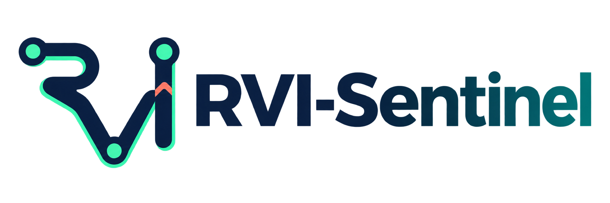
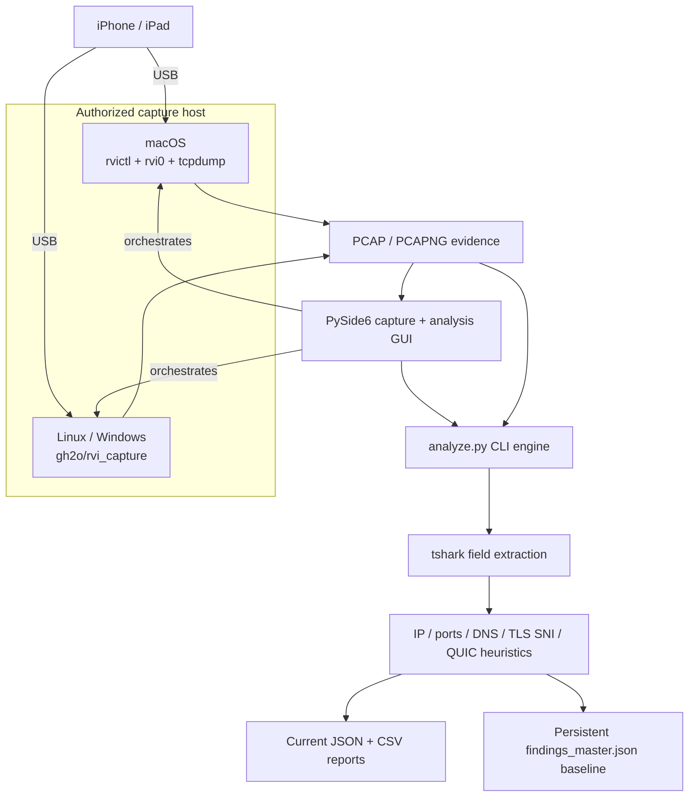
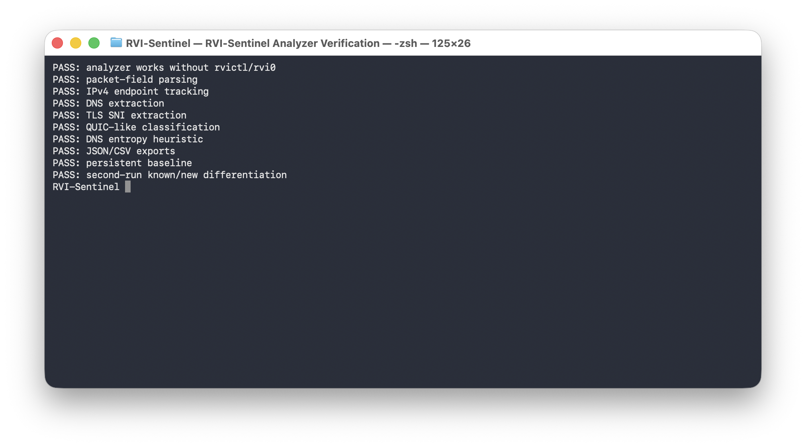
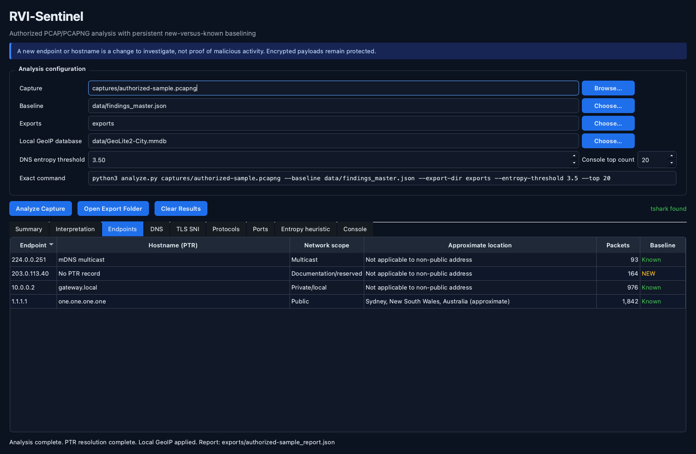
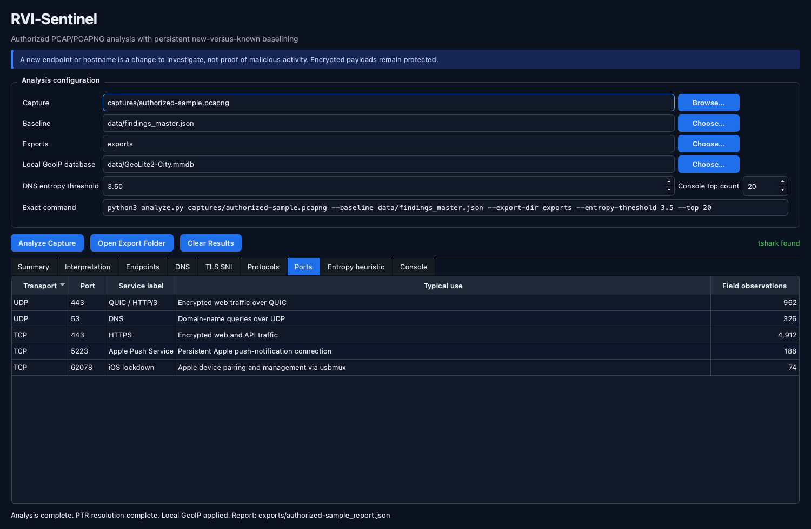
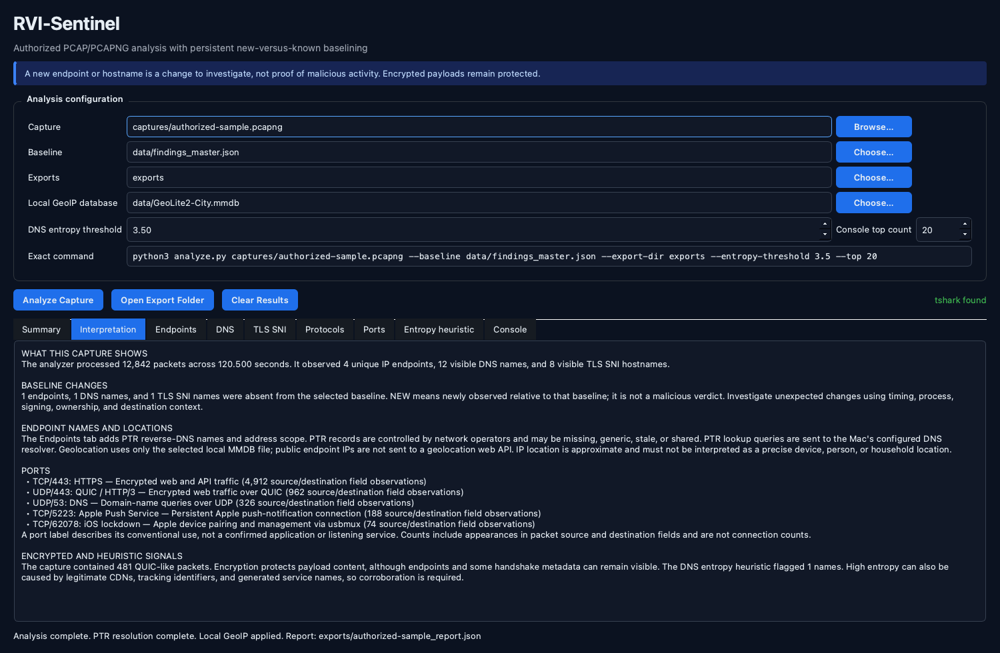

# RVI-Sentinel

### Cross-platform iPhone/iPad packet capture and persistent network-baseline analysis

<p align="center">
  <picture>
    <source media="(prefers-color-scheme: dark)" srcset="assets/branding-v2/github/readme-logo-on-dark.png">
    
  </picture>
</p>


> **Scope:** RVI-Sentinel is a defensive, cross-platform toolkit for authorized iPhone/iPad packet capture and persistent network-baseline analysis. It combines Apple's native Remote Virtual Interface workflow on macOS with the upstream `gh2o/rvi_capture` backend on Linux and Windows, while keeping capture and analysis independent.

---

## Table of Contents

- [Overview](#overview)
- [Executive Summary](#executive-summary)
- [Overall Architecture](#overall-architecture)
- [Verified Analyzer Screenshot](#verified-analyzer-screenshot)
- [Installation](#installation)
- [Desktop GUI](#desktop-gui)
- [Analyze an Existing Capture](#analyze-an-existing-capture)
- [macOS Capture with Apple RVI](#macos-capture-with-apple-rvi)
- [Linux and Windows Capture](#linux-and-windows-capture)
  - [ChromeOS (Chromebook) Capture](#chromeos-chromebook-prerequisites)
- [Persistent Baselining](#persistent-baselining)
- [Current Analysis Fields](#current-analysis-fields)
- [Encryption Limitations](#encryption-limitations)
- [Testing Without Live Capture](#testing-without-live-capture)
- [Repository Structure](#repository-structure)
- [Privacy and Responsible Use](#privacy-and-responsible-use)
- [Evidence and Provenance](#evidence-and-provenance)
- [Conclusions](#conclusions)
- [Upstream Source](#upstream-source)
- [Community Standards](#community-standards)
- [License](#license)

---

## Overview

RVI-Sentinel is a defensive network-analysis toolkit for inspecting packet captures over time. It supports Apple's native Remote Virtual Interface (`rvictl`) workflow on macOS and integrates the upstream [`gh2o/rvi_capture`](https://github.com/gh2o/rvi_capture) project for iPhone/iPad packet capture on Linux and Windows.

The project deliberately separates **capture** from **analysis**:

> A packet capture shows what happened during one session. A persistent baseline shows what changed.

The analyzer works with ordinary `.pcap` and `.pcapng` files from any authorized source. An iPhone, `rvictl`, or `rvi0` is not required to use the analysis engine.

---

## Executive Summary

- macOS iPhone/iPad capture with Apple `rvictl` + `rvi0` + `tcpdump`.
- Linux and Windows iPhone/iPad capture through [`gh2o/rvi_capture`](https://github.com/gh2o/rvi_capture).
- ChromeOS (Chromebook) capture through the built-in Linux development environment, using the Linux workflow.
- PCAP and PCAPNG analysis through `tshark`.
- IPv4 and IPv6 endpoint inventory.
- TCP and UDP port-frequency analysis.
- DNS query extraction.
- TLS Server Name Indication (SNI) extraction when visible.
- QUIC/HTTP/3-style traffic heuristics, including UDP/443 activity.
- DNS-label Shannon entropy heuristic for generated or encoded-looking names.
- Persistent first-seen / last-seen observations across captures.
- New-vs-known endpoint, DNS, and TLS-hostname detection.
- JSON investigation reports and CSV exports.
- Deterministic integration test that validates analysis without live capture.

### Direct capability vs. interpretation

| Type | Finding |
|---|---|
| **Direct capability** | `capture_rvi.sh` drives Apple's `rvictl` / `rvi0` / `tcpdump` workflow on macOS. |
| **Direct capability** | `capture_mobile.py` integrates the separately fetched `gh2o/rvi_capture` backend for Linux and Windows. |
| **Direct capability** | `analyze.py` accepts authorized PCAP or PCAPNG input and produces persistent JSON plus CSV findings. |
| **Direct verification** | The deterministic analyzer integration test passes without an iPhone, `rvictl`, or `rvi0`. |
| **Interpretation boundary** | A newly observed endpoint or hostname is a baseline change, not proof of malicious activity. |
| **Visibility boundary** | Packet metadata does not defeat TLS, QUIC, VPNs, Private Relay, encrypted DNS, ECH, or application-layer encryption. |

---

## Overall Architecture



The two capture paths converge on the same host-independent analysis pipeline.

<details>
<summary>Text-only architecture</summary>

```text
                              iPhone / iPad
                                   |
                                   | USB
                    +--------------+--------------+
                    |                             |
                  macOS                    Linux / Windows
                    |                             |
                 rvictl                    gh2o/rvi_capture
                    |                             |
                  rvi0                            |
                    |                             |
                 tcpdump                          |
                    +--------------+--------------+
                                   |
                                   v
                              PCAP / PCAPNG
                                   |
                                   v
                                tshark
                                   |
                      +------------+------------+
                      |            |            |
                      v            v            v
                 IP / ports       DNS       TLS / QUIC
                      |            |            |
                      +------------+------------+
                                   |
                                   v
                              analyze.py
                                   |
                      +------------+------------+
                      |                         |
                      v                         v
                 Current report            Persistent state
                  JSON + CSV              findings_master.json
```

</details>

The key design rule is:

```text
CAPTURE LAYER != ANALYSIS LAYER
```

---

## Verified Analyzer Screenshot



The screenshot records the repository's deterministic analyzer integration test. It verifies packet-field parsing, IPv4 endpoint tracking, DNS and TLS SNI extraction, QUIC-like classification, DNS entropy handling, JSON/CSV exports, persistent baselining, and known/new differentiation without requiring live device capture.

---

## Installation

Clone RVI-Sentinel:

```bash
git clone https://github.com/hideouts-io/RVI-Sentinel.git
cd RVI-Sentinel
```

Check the analyzer:

```bash
python3 analyze.py --help
```

The CLI analyzer uses Python's standard library. Packet decoding requires `tshark`, the command-line component of Wireshark. The optional desktop GUI uses PySide6.

---

## Desktop GUI

The desktop GUI uses a sidebar for Overview, Check setup, Device & Capture, Analysis, Baselines, Exports, and Diagnostics. Overview cards open the existing workflows; selecting a section never starts a capture, analysis, name lookup, or baseline update. The host system palette controls light and dark appearance. It supports:

- recognizing physical iPhone/iPad devices and showing connected-versus-offline state;
- selecting a connected device in a guided capture dialog;
- choosing a bounded capture duration from 5 seconds to 60 minutes;
- choosing PCAPNG or PCAP and a local output path without overwriting existing evidence;
- macOS readiness checks through Apple `devicectl`, followed by `rvictl`, a temporary RVI interface, and `tcpdump`;
- Linux/Windows capture through the separately installed `gh2o/rvi_capture` backend;
- pass/fail setup checks for trust, USB access, capture backend, `tshark`, output-folder permissions, and disk space, with a specific fix for each failure;
- live progress, cancellation, retryable no-traffic preflight, and platform-specific errors;
- a final capture receipt and completion card with SHA-256, full readable packet count, positive-data count, file size, exact packet span, requested duration, observed recording lifetime when available, and independent cleanup outcomes;

- selecting or dropping an authorized PCAP, PCAPNG, or CAP file;
- using a separate suggested baseline per device or imported investigation;
- read-only analysis by default, followed by an explicit **Add findings to baseline** action;
- configuring the DNS entropy threshold and console result count;
- hiding device identifiers, exact commands, and raw process output under **Advanced details**;
- copying redacted diagnostics that exclude device identifiers, packet data, and private paths;
- summary, endpoint, DNS, TLS SNI, protocol, port, and entropy-heuristic views;
- passive address-scope labels, with current PTR names available through an explicit action;
- original-byte SHA-256, decoder-field coverage, and retained packet-record counts;
- optional local MaxMind-compatible GeoIP city/country lookup without a web API;
- TCP/UDP-aware service labels and plain-language port explanations;
- a report-specific Interpretation view that explains scope, caveats, and next steps;
- explicit new-versus-known baseline labels;
- opening the generated export directory.

On macOS or Linux, create a project-local environment and install the optional GUI dependencies:

```bash
python3 -m venv venv
venv/bin/python -m pip install -r requirements-gui.txt
```

On Windows, use PowerShell from the repository root:

```powershell
py -3.13 -m venv venv
.\venv\Scripts\python.exe -m pip install -r requirements-gui.txt
.\venv\Scripts\python.exe gui.py
```

Install TShark separately and make its executable available on `PATH` for saved-file analysis. The GUI keeps its Python helper text pipes in UTF-8, including filenames and diagnostics containing Unicode.

Use the non-hidden `venv/` directory shown above. In macOS File Provider-managed folders, a dot-prefixed environment such as `.venv/` can propagate the hidden file flag to Qt plugins and prevent the Cocoa platform plugin from being discovered.

Launch the GUI on macOS:

```bash
./scripts/run_gui.sh
```

On Linux, launch it directly from the project environment:

```bash
venv/bin/python gui.py
```

The direct Python entry point accepts a saved capture path and `--smoke-test` on each platform. `scripts/run_gui.sh` requires zsh; the direct Linux and Windows commands do not.

On macOS, the launcher builds and ad-hoc signs a lightweight runtime app wrapper in the system temporary directory, outside a File Provider-managed Documents checkout. It starts with the project icon so RVI-Sentinel has its own Dock identity while all source, captures, baselines, and exports remain at their selected project paths. The generated wrapper stays outside version control and is recreated by `scripts/run_gui.sh`.

The app opens on **Overview**. Choose **Device & Capture** in the sidebar to record traffic, or choose **Analysis** and **Open capture…** to inspect a saved file. Analysis settings are available through **Show settings**; the compact **Show** selector switches between result pages. Connect the device by USB, unlock it, trust the host if prompted, and choose **Refresh Devices**. **New Capture…** opens a dialog for the device, duration, format, and output path. Offline devices are recognized but cannot be selected until connected. The **Check setup** sidebar section verifies the local prerequisites before capture. On ChromeOS, USB devices must be shared with Linux individually under **Settings > Developers > Linux > USB preferences**; see Google's [Linux on ChromeOS FAQ](https://developers.google.com/chromeos/app-development/develop/linux-on-chromeos-faq).

On macOS, the timed capture requires a physical, booted, paired iPhone/iPad connected over USB. It then uses a narrow native administrator authorization prompt for `tcpdump`; RVI-Sentinel never asks for, reads, stores, or transmits the Mac password. The countdown stays stopped while authorization is pending and during a five-second live-packet preflight. If the connected phone is idle, open a webpage on it and choose **Retry Traffic Check** without re-entering the capture settings. The guided workflow attempts cleanup before emitting its final typed receipt. It requires complete passive TShark decoding of stable original bytes, the requested PCAP/PCAPNG format, and positive captured data for overall success. Recording outcome, artifact validation, recording-process shutdown, and interface removal are reported independently. A verified saved file remains available for manual passive analysis when recording or cleanup failed. Interface removal is claimed only after verification for an interface consistently attributed to this session; preexisting or ambiguously owned interfaces are preserved. The completion card remains in **Device & Capture** so the user chooses what happens next. The separate capture_rvi.sh and capture_mobile.py entrypoints retain their existing contracts; they do not emit guided receipts.

On Linux (including the ChromeOS Linux development environment) and Windows, choose **Install Capture Support** once to clone the canonical `gh2o/rvi_capture` source into the ignored local `tools/` directory. Linux still requires `libimobiledevice` and `usbmuxd`; Windows still requires iTunes or Apple Mobile Device Support and its running service.

Optionally open an existing capture immediately:

```bash
./scripts/run_gui.sh captures/authorized-capture.pcapng
```

Analysis requires the same `tshark` runtime dependency as the CLI analyzer. Live capture follows the platform-specific prerequisites below and never bypasses device trust, host authorization, or encryption.

### Local GeoIP setup

Geolocation is deliberately local-only: RVI-Sentinel never sends captured endpoint IP addresses to a geolocation web API. To add approximate locations, download a current MaxMind-compatible City or Country `.mmdb` database, keep it outside version control (the repository's `data/` contents are ignored), and choose it in **Local GeoIP database** before analysis. MaxMind provides [GeoLite downloadable databases](https://dev.maxmind.com/geoip/geolite2-free-geolocation-data/) after account and license-key setup.

IP geolocation is approximate. It often represents a network or nearby population center and must not be interpreted as the exact location of a device, person, or household. Saved-file analysis and automatic local GeoIP enrichment perform no PTR lookup. Choose **Resolve current PTR names** to query the host's configured DNS resolver explicitly; request/completion times and the result source are shown separately from captured DNS/SNI. PTR names may be absent, generic, stale, shared, or controlled by a hosting provider. **Cancel lookup** stops the current enrichment process; results do not alter the capture, report or baseline.

### Guided capture receipts and timing

Schema-v1 receipts carry a request nonce, exact selected output path, requested format/duration, recording outcome, full-file validation, artifact digest/count/timestamps, independent process/interface cleanup states, and distinct failure codes. The GUI rejects stale, malformed, duplicate, or missing receipts and does not infer successful capture or teardown from helper exit or file existence. A zero-length decoded frame is retained as readable frame evidence; it does not count as positive captured traffic.

Requested duration, packet timestamp span, and observed recording lifetime are different quantities. A one-packet file has a zero packet span. Current macOS and upstream mobile connectors do not acknowledge the actual recording boundaries, so recording lifetime is explicitly unavailable. Authorization, startup, validation, cleanup, and provider process lifetime are not presented as recording duration.

Cancellation requests cooperative owned-child shutdown. The native helper escalates from an interrupt through bounded termination, and a durable acknowledgement follows child reaping; killing the authorization wrapper alone leaves recording shutdown unverified. The GUI has a request-scoped 60-second escalation deadline. Verification of a saved partial file after cancellation has a 10-second cooperative deadline; an interrupted verification never promotes a completed artifact and preserves the file for later import.

Streaming artifact verification retains counts and timestamp bounds without keeping a packet index. Its independent failure ceilings are 8 GiB input, 4 GiB decoder output, 4 KiB rows, 64 KiB diagnostics, 32 MiB capability probes, 30 seconds per probe, and 1,800 seconds overall. A generated 200,001-frame integration validates streaming behavior above the optional packet index limit; these ceilings are not full-capacity or UI-latency claims.

Analysis started from the completion card checks the receipt digest before publishing reports. Changed bytes fail without replacing exports or updating the baseline. Explicitly selecting or dropping the file as a new import begins a fresh passive review with imported origin unknown.

### Traceable saved-file analysis

The analyzer probes the installed TShark field catalog, requests supported fields with active resolution disabled, and hashes the original before and after decoding. Every capture pass reads the already-open original descriptor, so replacing a source directory cannot substitute different decoded bytes under the original hash. Schema-v2 JSON reports retain the digest, unknown imported origin, supported/unavailable decoder fields, exact decimal packet epochs, frame numbers, lengths, streams and raw decoded field occurrences. Optional Apple PCAPNG/PKTAP process, effective-process, interface and direction labels retain their evidence source and explicit unknown/conflicting states. Recorded labels do not independently verify a device process owner. Unsupported decoder fields are distinct from supported fields absent in the capture; metadata-free PCAP remains useful.

Existing endpoint/DNS/SNI/protocol/port summaries and CSVs remain available. Schema v2 counts all decoded field occurrences, including DNS questions previously omitted by first-occurrence extraction; ordinary single-occurrence frames keep their previous counts. Endpoint/port appearances do not establish connections, and ambiguous layered fields are not paired into invented endpoints. Packet records and structured DNS evidence are retained in the local JSON report; the Qt packet timeline, scoped TCP/UDP sessions, passive DNS candidates and decoded-field inspectors described below are available. Raw-byte inspection remains a separate capability.

Saved analysis rejects changed originals, empty files, zero decoded records, nonregular/link inputs, malformed fields, incomplete frame coverage and exceeded resource limits. A valid container's zero-length frame is retained explicitly with no inferred network evidence. The configured ceilings are 1 GiB input, 200,000 records, 256 MiB estimated retained values, 128 KiB per decoder row, 512 MiB decoder output, 64 KiB diagnostics, 30 seconds per tool probe and 300 seconds for original hashing/decoding. JSON output is bounded at 512 MiB. These are explicit failure ceilings, not measured capacity or GUI-responsiveness claims. Choose a smaller saved capture when a limit is reached; analysis never silently truncates a successful report.

Preview leaves the selected baseline unchanged, and **Add findings to baseline** requires the exact SHA-256 reviewed in that preview. Changed bytes require a new preview. Baseline observation counts still count reviewed analyses, while new capture references use content hashes and older history remains intact. Output paths must not alias a capture, baseline or another export, and staged JSON/baseline writes avoid truncating existing evidence. Individual output files are published atomically; the CSV/JSON bundle is not a multi-file transaction.

For CLI preview without updating a baseline:

```bash
python3 analyze_preview.py captures/authorized.pcapng \
  --baseline data/findings_master.json --export-dir exports \
  --entropy-threshold 3.5 --top 20
```

The existing `analyze.py` CLI still explicitly updates its selected baseline. **Cancel analysis** in the GUI applies to preview; confirmed baseline persistence is not cancelled through that control.

### GUI screenshots

These screenshots use a deterministic synthetic report and documentation-only sample values. No private capture, endpoint list, baseline, or generated report is included.

#### Endpoint names, scope, and approximate location



The Endpoints view keeps packet counts and baseline status alongside PTR hostname hints, address scope, and optional local-only GeoIP results.

#### Transport-aware port labels



TCP and UDP observations remain distinct so the GUI can explain common uses such as TCP/443 HTTPS, UDP/443 QUIC/HTTP/3, UDP/53 DNS, TCP/5223 Apple Push Service, and TCP/62078 iOS lockdown. A conventional port label is context, not proof that a particular process or server was present.

#### Plain-language findings interpretation



The Interpretation view explains the report-specific counts, new-versus-known baseline changes, endpoint-attribution limits, port observations, encrypted traffic, and entropy findings without turning a heuristic or newly observed value into a malicious verdict.

---

## Analyze an Existing Capture

Given:

```text
capture.pcapng
```

run:

```bash
python3 analyze.py capture.pcapng
```

Outputs are written to:

```text
data/findings_master.json

exports/
├── capture_report.json
├── capture_endpoints.csv
├── capture_dns.csv
└── capture_tls_sni.csv
```

Use a dedicated baseline for one device or investigation:

```bash
python3 analyze.py capture.pcapng \
  --baseline data/iphone_baseline.json \
  --export-dir exports/iphone
```

---

## macOS Capture with Apple RVI

Connect and trust the iPhone/iPad over USB.

Find its UDID:

```bash
xcrun xctrace list devices
```

Start RVI:

```bash
./capture_rvi.sh start <UDID>
```

or directly:

```bash
rvictl -s <UDID>
```

A virtual interface such as `rvi0` should appear:

```bash
ifconfig rvi0
```

Capture:

```bash
./capture_rvi.sh capture captures/ios_capture.pcapng
```

Equivalent manual command:

```bash
sudo tcpdump -i rvi0 -n -s 0 -U --apple-pcapng -Z "$USER" \
  -w captures/ios_capture.pcapng
```

Analyze:

```bash
python3 analyze.py captures/ios_capture.pcapng
```

Stop RVI:

```bash
./capture_rvi.sh stop <UDID>
```

---

## Linux and Windows Capture

### Capture with `gh2o/rvi_capture`

RVI-Sentinel integrates the open-source project:

**https://github.com/gh2o/rvi_capture**

The upstream project describes itself as **`rvictl for Linux and Windows`** and creates packet-capture dumps from connected iOS devices. It supports both PCAP and PCAPNG, optional UDID selection, file/FIFO output, stdout streaming, and direct Wireshark streaming.

RVI-Sentinel does **not** copy the upstream Python implementation into this repository. Instead, the setup helper clones the canonical source directly so provenance remains clear.

Install the upstream capture backend locally:

```bash
python3 scripts/setup_rvi_capture.py
```

It is placed at:

```text
tools/rvi_capture/
```

That directory is intentionally ignored by Git.

Update the upstream checkout later with:

```bash
python3 scripts/setup_rvi_capture.py --update
```

The setup helper prints the exact upstream commit SHA so you can record which capture implementation produced a packet trace.

See [`SOURCES.md`](SOURCES.md) for attribution and provenance details.

---

## Linux prerequisites

Upstream documents the following requirements:

- Python 3
- `libimobiledevice`
- `usbmuxd` running

On Debian/Ubuntu-derived systems, a typical starting point is:

```bash
sudo apt update
sudo apt install python3 libimobiledevice-utils usbmuxd
```

Confirm that the connected device is visible:

```bash
idevice_id -l
```

Install the upstream backend:

```bash
python3 scripts/setup_rvi_capture.py
```

Capture an iPhone/iPad to PCAPNG:

```bash
python3 capture_mobile.py \
  captures/iphone_linux.pcapng
```

Select a particular device:

```bash
python3 capture_mobile.py \
  --udid <IPHONE_UDID> \
  captures/iphone_linux.pcapng
```

Capture and immediately analyze:

```bash
python3 capture_mobile.py \
  --analyze \
  captures/iphone_linux.pcapng
```

---

## Windows prerequisites

Upstream documents the following requirements:

- Python 3
- iTunes / Apple mobile-device components
- `AppleMobileDeviceService.exe` running

The upstream project states that its required `libimobiledevice` components are downloaded as needed on Windows.

From PowerShell:

```powershell
python scripts\setup_rvi_capture.py
```

Capture:

```powershell
python capture_mobile.py `
  captures\iphone_windows.pcapng
```

Specify the UDID:

```powershell
python capture_mobile.py `
  --udid <IPHONE_UDID> `
  captures\iphone_windows.pcapng
```

Capture and analyze in one workflow:

```powershell
python capture_mobile.py `
  --analyze `
  captures\iphone_windows.pcapng
```

---

## ChromeOS (Chromebook) prerequisites

On a Chromebook, RVI-Sentinel runs inside ChromeOS's built-in **Linux development environment**, a Debian container. Capture uses the same `gh2o/rvi_capture` backend and the same commands as [Linux](#linux-prerequisites); the ChromeOS-specific parts are enabling Linux and sharing the iPhone or iPad with it over USB.

> [!NOTE]
> Managed (school or work) Chromebooks may have Linux or USB sharing turned off by the administrator. If you can't enable either setting below, capture isn't available on that device. You can still analyze existing `.pcap`/`.pcapng` files on any host.

### 1. Turn on the Linux development environment

Open **Settings → About ChromeOS → Developers → Linux development environment**, choose **Set up**, and follow the prompts. When it finishes, a **Terminal** app opens with a Linux shell.

### 2. Share the iPhone or iPad with Linux

ChromeOS doesn't pass USB devices to Linux automatically:

1. Connect the device with a data-capable cable, unlock it, and keep it unlocked.
2. When ChromeOS shows a notification for the device, choose **Connect to Linux**. Or open **Settings → About ChromeOS → Developers → Linux development environment → Manage USB devices** and turn the device on.
3. Tap **Trust** on the device if it asks.

Reconnect or re-share the device after unplugging it or restarting Linux.

### 3. Install the prerequisites in the Linux terminal

The container is Debian-based, so the [Linux prerequisites](#linux-prerequisites) apply unchanged:

```bash
sudo apt update
sudo apt install python3 libimobiledevice-utils usbmuxd tshark git
```

Confirm the shared device is visible:

```bash
idevice_id -l
```

If nothing is listed, check that the device is still shared with Linux (step 2) and that `usbmuxd` is running:

```bash
sudo systemctl status usbmuxd
```

### 4. Capture

Clone RVI-Sentinel inside the Linux environment, install the upstream backend, and capture exactly as on Linux:

```bash
git clone https://github.com/hideouts-io/RVI-Sentinel.git
cd RVI-Sentinel
python3 scripts/setup_rvi_capture.py
python3 capture_mobile.py \
  --analyze \
  captures/iphone_chromeos.pcapng
```

Captures, baselines, and reports are written inside the Linux container. To open them from the ChromeOS **Files** app, look under **Linux files**.

---

## Direct upstream usage

After running the setup helper, you can invoke upstream `rvi_capture.py` directly.

Linux:

```bash
python3 tools/rvi_capture/rvi_capture.py \
  --format pcapng \
  --udid <IPHONE_UDID> \
  captures/iphone.pcapng
```

Windows PowerShell:

```powershell
python tools\rvi_capture\rvi_capture.py `
  --format pcapng `
  --udid <IPHONE_UDID> `
  captures\iphone.pcapng
```

If `--udid` is omitted, upstream selects the first device it finds.

Then analyze normally:

```bash
python3 analyze.py captures/iphone.pcapng
```

---

## Stream directly into Wireshark

The upstream project can write capture data to stdout:

```bash
./tools/rvi_capture/rvi_capture.py - | wireshark -k -i -
```

For RVI-Sentinel investigations, saving a PCAPNG first is often preferable because it creates a repeatable evidence artifact that can be re-analyzed later.

---

## iOS interface metadata

PCAPNG can retain interface metadata. The upstream `rvi_capture` documentation discusses iOS interfaces such as:

```text
en0       Wi-Fi
pdp_ip0   cellular
ipsec1    IPSec outer transport observed for VoLTE
ipsec3    IPSec inner transport observed for VoLTE
```

In Wireshark, inspect:

```text
frame.interface_name
```

This can help distinguish traffic paths when the capture includes the relevant metadata.

---

## Cross-platform capture matrix

| Host OS | iPhone/iPad capture backend | Output | RVI-Sentinel analysis |
|---|---|---|---|
| macOS | Apple `rvictl` + `tcpdump` | PCAP/PCAPNG | Yes |
| Linux | `gh2o/rvi_capture` + `libimobiledevice`/`usbmuxd` | PCAP/PCAPNG | Yes |
| Windows | `gh2o/rvi_capture` + Apple mobile-device services | PCAP/PCAPNG | Yes |
| ChromeOS | `gh2o/rvi_capture` + `libimobiledevice`/`usbmuxd` in the Linux development environment | PCAP/PCAPNG | Yes |
| Any analysis host | Existing authorized PCAP/PCAPNG | PCAP/PCAPNG | Yes |

---

## Persistent Baselining

The default state database is:

```text
data/findings_master.json
```

For observed endpoints, DNS names, and visible TLS SNI values, RVI-Sentinel records historical context including first seen, last seen, observation counts, capture membership, and recent capture counts.

This allows a later capture to distinguish previously observed infrastructure from newly observed infrastructure.

A new endpoint or hostname is **not automatically suspicious**. It is simply a change worth contextualizing.

---

## Current analysis fields

RVI-Sentinel asks `tshark` for fields including:

```text
frame.time_epoch
ip.src
ip.dst
ipv6.src
ipv6.dst
tcp.srcport
tcp.dstport
udp.srcport
udp.dstport
dns.qry.name
tls.handshake.extensions_server_name
_ws.col.Protocol
```

---

## Encryption limitations

RVI packet visibility does not defeat TLS, QUIC, VPN encryption, iCloud Private Relay, encrypted DNS, ECH, or application-layer encryption.

You may still observe useful metadata such as source/destination addresses, ports, timing, traffic volume, unencrypted DNS, visible TLS SNI, and protocol classifications.

RVI-Sentinel does not attempt to bypass device security controls or decrypt protected application content.

---

### Packet timeline and inspector

After a saved capture is analyzed, **Packets** in the Analysis **Show** selector shows a time-ordered timeline beside a read-only decoded-field inspector. Ordering uses exact integer seconds and nanoseconds, then original frame number. Selection is bound to the capture SHA-256 and frame number, so table row positions cannot reattribute a packet after filtering or report replacement. Legacy aggregate-only reports show packet evidence as unavailable while retaining their existing findings.

Enter literal case-insensitive search text or combine filters for an exact IP address on either side, either port, a complete protocol label/layer, recorded or effective process text, regular process state, interface text/state, and direction. Choose **Apply filters** or press Enter. Filters combine with AND; search has no regular-expression or operator syntax. Endpoint and port filters include every recorded layer occurrence and do not establish an endpoint/port pairing. Unknown and conflicting labels remain distinct. Process-state filtering applies to the regular process; effective-process labels remain searchable and visible in the inspector.

Pages contain 100, 250, or 500 rows with exact total, matching, and page counts. Navigation uses the last applied filters. A selected packet stays selected when it matches; when outside the filter or visible page, its original inspector remains with an explicit notice. **Cancel query** keeps the last completed page and inspector for ordinary filters; an unfinished scope transition explicitly reports that no completed page is available. Replacing the loaded report clears old selection and pending results, including reloads of the same capture. Indexing, search, filtering, paging and report validation run in owned workers with one active query and one latest pending query per view. Window close and application Quit wait for owned workers to stop.

The inspector preserves the exact epoch and nanosecond UTC display, hash/frame identity, endpoints and ports, lengths, protocol layers, transport/stream, every recorded process/effective-process/interface/direction label and source, repeated decoded field values, and diagnostics. Decoder-supported fields absent on this packet are distinct from unsupported fields. It also identifies the packet's scoped session or explains why it is ungrouped. The view renders literal text and performs no DNS/PTR lookup, capture mutation, baseline update, or export. It shows decoded fields; raw packet bytes are not inferred.

Only the visible page is exposed to Qt's table model. Metadata cells exceeding 8 KiB show an explicit label-count summary. Inspector text exceeding 512 KiB is refused explicitly as a whole; hash/frame identity and the complete original report remain available. Report loading rejects links and special files, checks stable file identity, limits serialized input to 512 MiB, and enforces the existing 200,000-record and 256 MiB estimated retained-value ceilings. These are failure/rendering limits, not full-capacity or latency guarantees. Generated 50k/100k queries and real 10k-frame report loading are measured separately in the GUI integration suite; shared-metadata query fixtures do not establish decoder-inclusive RSS or physical-device behavior.

### Scoped sessions and packet navigation

**Sessions** in the Analysis **Show** selector groups saved TCP/UDP observations only when a decoder stream and an unambiguous complete address/port pair are available. A group is scoped by capture SHA-256, transport, stream, normalized bidirectional endpoint pair, recorded interface context, and both regular and effective process contexts. Metadata sources are part of the scope. Reverse directions join; TCP and UDP streams with the same number, different endpoints, interfaces or process labels remain separate. Unknown context is an exact scope and never a wildcard for recorded context. Conflicting process, effective-process, interface or direction evidence, ambiguous headers, missing endpoints/ports/streams and other transports remain ungrouped with explicit reasons. A frame may have several reasons, so reason counts need not sum to the unique ungrouped count.

Sessions show literal search, combined endpoint/port/transport/process/interface filters, exact packet and session counts, and bounded 100/250/500-row pages. The scope inspector shows original metadata sources, exact first/last observed timestamps, wire bytes and captured bytes; unavailable captured lengths stay explicit. A stable versioned scope digest identifies each group within its capture. Grouping preserves the original immutable records and partitions every frame into one eligible session or one ungrouped entry. This is passive correlation of saved observations: it does not prove TCP state, connection lifetime, process ownership or completeness, and does not invent idle-time boundaries. DNS candidate associations have the additional evidence boundaries described below.

**Show member packets** opens a timeline restricted to that group's exact frame identities. **Show ungrouped packets** exposes excluded frames and their reasons. From a selected packet, **Show owning session** reveals its group while retaining the packet return context; the label describes grouping, not forensic ownership. **Return to previous packet view** restores that packet scope, applied filters, page, selection and inspector. **Back to sessions** restores the originating session view. **Restore previous packet view** on the packet page restores the packet view that preceded session navigation. Return snapshots also preserve table scroll position and are invalidated on every report replacement. Analysis settings collapse on entering a packet, session, or DNS evidence page to leave room for rows and inspectors; **Show settings** reopens them.

Correlation runs locally in a cancellable worker. The additional session index has a 200,000-frame ceiling and a 256 MiB estimated storage ceiling, separate from report retention; these estimates are not process RSS limits. The session GUI integration suite measures generated 50k/100k-frame corpora containing 25k/50k distinct bidirectional groups with varied process and interface labels, independently from small real-decoder PCAP/PCAPNG fixtures. Neither establishes full-capacity responsiveness or physical-device metadata availability.

### Passive DNS evidence and session navigation

**DNS evidence** in the Analysis **Show** selector shows candidate name/address associations with scoped sessions. Saved files containing DNS, mDNS or LLMNR receive a separate passive structured TShark pass with active name resolution disabled. The report retains message boundaries, questions, answer owners/types/classes/TTLs/values, flags, complete response codes, decoder frame/message ordinals and linked query frames. Authority and additional records cannot supply answer candidates. Older reports without this optional schema-v2 evidence show it as unavailable; an analyzed file with no observed DNS messages has an explicit empty collection.

A candidate requires a captured, uniquely linked standard unicast DNS query and response on port 53, with the same transport/stream, reversed endpoint tuple and exact interface context. Only one IN A or AAAA question and a successful, untruncated response can produce an association. An unambiguous acyclic CNAME chain is followed for at most 16 hops. Its validity uses the minimum CNAME and terminal RRset TTL; zero and invalid high-bit TTLs do not associate later traffic. Unsupported records, multicast/LLMNR, errors, unlinked or ambiguous messages and metadata conflicts stay inspectable with explicit exclusion reasons.

Only original session member frames matching the client, answer address and interface within the half-open response-to-expiry window are associated. Query/response packets themselves are excluded. The inspector shows both the original TTL expiry and the effective expiry after a later linked negative, replacement or dependency response, with navigation to that superseding source. CNAME/address replacements end earlier dependency evidence while independent A and AAAA records remain separate. Multiple names sharing an IP stay separate candidates. Captured DNS does not authenticate a resolver or prove application name use or process ownership; recorded response/session process context is compared explicitly as same, different or unknown.

From a session, **Show DNS evidence** applies its exact scope. A selected candidate can open its original query, response or superseding response packet, only its matched member packets, or its correlated session. Return actions restore the originating filters, page, selection, inspector and scroll position. Every reference is bound to the capture SHA-256 and original frame/record identity, and report reloads invalidate old navigation even when the digest is unchanged. Packet inspectors also show complete structured DNS message evidence, including NXDOMAIN and extended response codes. Observed DNS frames and excluded-message diagnostics remain available even when no candidate qualifies.

All correlation and navigation are local and leave the capture, report, exports and baseline unchanged. DNS parsing has separate 64 MiB serialized/estimated-retention limits, 100,000 messages, 200,000 combined questions/answer records, 48-level JSON depth and 1,024-byte names. Correlation fails explicitly above 200,000 associations, 64 MiB estimated association storage or 2,000,000 member/candidate comparisons. These are failure ceilings, not full-capacity RSS or responsiveness claims. Cancelling a query preserves its last completed page; window close and application Quit wait for owned workers.

## Testing without live capture

For the dependency-free deterministic analyzer check, run:

```bash
python3 tests/test_analyzer.py
```

The complete analyzer, real-decoder, capture-receipt, packet/session/DNS, Qt and native launcher commands are maintained in [CONTRIBUTING.md](CONTRIBUTING.md#validation). Run those checks for a complete port checkpoint.

The automated tests do not connect to an iPhone, invoke `rvictl`, create `rvi0`, request administrator authorization, or capture live traffic. They validate physical-device readiness parsing, bounded capture requests, Apple PCAP/PCAPNG mode selection, bounded child shutdown, complete-file validation, receipt binding and independent cleanup outcomes, countdown/finalization state, deterministic `tshark` field output, and the analysis layer independently. Live validation remains an explicit local action because it requires a connected trusted device and native authorization.

The GUI integration test uses the same deterministic field stream to exercise Qt process execution, report loading, results presentation, passive enrichment, explicit localhost PTR and cancellation without displaying a window or requiring live capture. The saved-file suite requires real TShark on PATH and generates valid classic PCAP and metadata-rich PCAPNG in temporary directories. It verifies original-byte integrity, exact timestamps, repeated DNS values, optional metadata, invalid inputs, resource limits and bounded child cleanup. Receipt tests execute generated shell commands against task-owned synthetic recorders and controlled connector boundaries, without a privileged device operation. Synthetic labels establish decoding, not metadata availability or process identity on every physical device.

Expected completion includes:

```text
PASS: analyzer works without rvictl/rvi0
```

---

## Repository structure

```text
RVI-Sentinel/
├── analyze.py
├── analyze_preview.py        # passive preview without baseline writes
├── analyze_reviewed.py       # digest-bound reviewed baseline update
├── analyze_captured.py       # receipt-bound passive preview before export
├── analysis_baseline.py      # validated v1 history and pure updates
├── packet_models.py          # immutable decoded evidence and report validation
├── saved_capture.py          # bounded passive decoding and original-byte integrity
├── capture_models.py          # typed device and bounded capture contracts
├── capture_devices.py         # macOS/Linux/Windows device discovery
├── capture_session.py         # timed platform-aware capture runner
├── capture_receipt.py         # final typed outcomes and strict GUI boundary
├── capture_stats.py           # complete streaming artifact validation
├── enrich_endpoints.py        # explicitly requested current PTR process
├── local_endpoint_enrichment.py # passive scope and local GeoIP process
├── finding_enrichment.py      # address, location, and port explanations
├── gui.py                     # PySide6 capture and analysis desktop UI
├── gui_shell.py               # sidebar, workflow cards and system palette
├── gui_models.py              # typed request/report and retained packet validation
├── report_loader.py           # owned cancellable Qt report worker
├── packet_timeline.py         # pure exact ordering, filters and bounded pages
├── packet_view.py             # Qt timeline model, query worker and inspector
├── packet_sessions.py         # pure evidence-scoped TCP/UDP grouping and queries
├── session_view.py            # Qt scoped session model, worker and inspector
├── capture_rvi.sh             # macOS rvictl/rvi0 capture
├── capture_mobile.py          # Linux/Windows frontend
├── scripts/
│   ├── run_gui.sh             # launch GUI from project environment
│   └── setup_rvi_capture.py   # fetch canonical gh2o/rvi_capture source
├── evidence/
│   └── rvi-sentinel-analyzer-test.png
├── .github/
│   ├── ISSUE_TEMPLATE/
│   │   ├── bug_report.yml
│   │   ├── feature_request.yml
│   │   └── config.yml
│   └── pull_request_template.md
├── CODE_OF_CONDUCT.md
├── CONTRIBUTING.md
├── SECURITY.md
├── SOURCES.md                 # upstream provenance/attribution
├── README.md
├── requirements.txt
├── requirements-gui.txt
├── LICENSE
├── .gitignore
├── tests/
│   ├── test_analyzer.py
│   ├── test_capture_models.py
│   ├── test_capture_stats.py
│   ├── test_capture_receipts.py
│   ├── test_packet_timeline.py
│   ├── test_packet_view.py
│   ├── test_packet_gui_integration.py
│   ├── packet_timeline_fixture.py
│   ├── test_packet_sessions.py
│   ├── test_session_view.py
│   ├── test_session_gui_integration.py
│   ├── session_fixture.py
│   ├── test_finding_enrichment.py
│   ├── test_saved_capture.py
│   ├── saved_capture_fixture.py
│   ├── test_gui_integration.py
│   └── test_gui_models.py
├── captures/
├── data/
├── exports/
└── tools/
    └── rvi_capture/           # local upstream clone; intentionally ignored
```

---

## Privacy and responsible use

Packet captures and device identifiers can reveal sensitive metadata even when payloads are encrypted. The repository ignores PCAP files, generated reports, local baselines, and the local upstream checkout by default. The GUI keeps capture files and device identifiers local and does not upload them.

Endpoint geolocation uses only the local `.mmdb` file selected by the user. RVI-Sentinel does not send captures, reports, DNS names, SNI values, or endpoint lists to a geolocation web API. Current PTR resolution queries the host's configured DNS resolver only after the explicit lookup action; saved-file analysis is passive.

Use RVI-Sentinel only with devices, networks, and packet captures you own or are explicitly authorized to inspect.

---

## Evidence and Provenance

This repository keeps capture provenance, analysis output, and interpretation separate:

| Layer | Evidence or record |
|---|---|
| **Capture implementation** | macOS uses Apple `rvictl` and `tcpdump`; Linux and Windows use a separately cloned canonical `gh2o/rvi_capture` checkout. |
| **Backend provenance** | `scripts/setup_rvi_capture.py` prints the exact upstream commit SHA after installation. |
| **Packet evidence** | PCAP or PCAPNG files remain independent inputs that can be retained and re-analyzed. |
| **Current findings** | JSON and CSV exports describe the supplied capture. |
| **Historical context** | The persistent baseline records first seen, last seen, counts, and capture membership. |
| **Verification evidence** | `tests/test_capture_models.py` validates discovery/capture contracts without a device; `tests/test_analyzer.py` validates analysis deterministically; the screenshot above records a passing analyzer run. |

Live device capture depends on the host OS, USB trust state, and the platform-specific prerequisites documented above. The deterministic test verifies the analysis pipeline, not a live macOS, Linux, or Windows device session.

For third-party attribution and redistribution boundaries, see [`SOURCES.md`](SOURCES.md).

---

## Conclusions

RVI-Sentinel provides three host capture paths with one common analysis model:

- macOS capture through Apple's native RVI tooling.
- Linux capture through `gh2o/rvi_capture`, `libimobiledevice`, and `usbmuxd`.
- Windows capture through `gh2o/rvi_capture` and Apple mobile-device services.
- Host-independent analysis of existing authorized PCAP and PCAPNG evidence.
- Persistent comparison of endpoints, DNS names, and visible TLS SNI across captures.
- Explicit limits: baseline changes require context, and encrypted content remains protected.

The central design principle is that capture produces evidence, while analysis and persistent baselining explain how that evidence differs from earlier observations.

---

## Upstream Source

Linux/Windows iOS capture functionality is provided by the separately maintained upstream project:

https://github.com/gh2o/rvi_capture

RVI-Sentinel's integration code does not claim authorship of that implementation. See [`SOURCES.md`](SOURCES.md).

---

## Community Standards

- Read the [Code of Conduct](CODE_OF_CONDUCT.md) before participating.
- Follow the [Contributing Guidelines](CONTRIBUTING.md) for setup, validation, privacy, and pull-request expectations.
- Report vulnerabilities privately through the [Security Policy](SECURITY.md).
- Use the structured GitHub issue forms for bugs and feature requests.

Never publish private captures, generated reports, baseline data, endpoint inventories, device identifiers, credentials, or unsanitized investigation logs in an issue or pull request.

---

## License

RVI-Sentinel's own project code is MIT licensed. See [`LICENSE`](LICENSE). Upstream dependencies retain their own copyright and licensing status.
